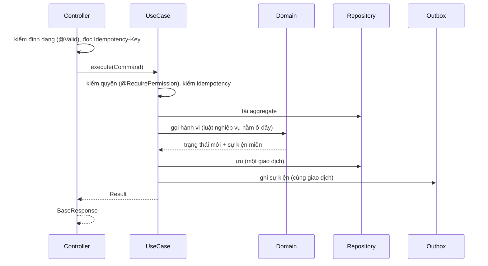

# Quy ước và checklist tech-forge

Tài liệu **sống**: dùng khi viết mã và khi review PR. Sửa tài liệu này bằng PR như sửa mã.
Nguồn: `docs/ke-hoach-phat-trien.md` (bản 3). Quyết định kiến trúc: `docs/adr/`.

Cách dùng:

| Khi | Đọc |
|---|---|
| Đặt tên lớp, bảng, đường dẫn, quyền, mã lỗi, topic | Mục 1 |
| Viết một tính năng | Mục 2.1 (luồng) và 2.2 (checklist) |
| Review PR | Mục 2.3 (cũng có trong mẫu PR) |
| Bắt đầu tính năng mới | `docs/templates/feature-spec.md` |

## 1. Quy ước đặt tên và khai báo

Mỗi dòng có ví dụ.

### 1.1 Module và gói

| Thứ | Quy ước | Ví dụ |
|---|---|---|
| Module service | `<miền>-service`, chữ thường, gạch ngang | `inventory-service` |
| Gói gốc | `com.htv.<miền>` (một từ, không gạch) | `com.htv.inventory` |
| Gói tầng | `domain.model`, `domain.repository`, `domain.service`, `domain.event`, `application.usecase`, `application.port`, `application.dto`, `infrastructure.persistence`, `infrastructure.client`, `infrastructure.messaging`, `infrastructure.config`, `interfaces.rest`, `interfaces.grpc`, `interfaces.messaging` | Như cây gói hiện có |
| Thêm gói service mới vào ArchUnit | `ArchitectureRules.SERVICE_PACKAGES` | `"com.htv.inventory"` |

### 1.2 Lớp

| Loại | Hậu tố | Nằm ở | Ví dụ |
|---|---|---|---|
| Entity JPA | `Entity` | `domain.model` | `StockItemEntity` |
| Value object | không hậu tố, `record` | `domain.model` | `Quantity`, `Sku` |
| Repository (cổng) | `Repository` | `domain.repository` | `StockLedgerRepository` |
| Cài đặt repository | `Jpa...Repository` | `infrastructure.persistence` | `JpaStockLedgerRepository` |
| Use case | động từ + `UseCase` | `application.usecase` | `ReceiveStockUseCase` |
| Lệnh vào use case | động từ + `Command` | `application.dto` | `ReceiveStockCommand` |
| Kết quả use case | danh từ + `Result` | `application.dto` | `StockLevelResult` |
| Cổng ra ngoài | danh từ + `Port` | `application.port` | `ProductCatalogPort` |
| Controller REST | danh từ + `Controller` | `interfaces.rest` | `StockController` |
| DTO REST vào/ra | `...Request`, `...Response` | `interfaces.rest` | `ReceiveStockRequest` |
| gRPC server | danh từ + `GrpcService` | `interfaces.grpc` | `StockQueryGrpcService` |
| Listener sự kiện | danh từ + `Listener` | `interfaces.messaging` | `OrderPlacedListener` |
| Feign client | danh từ + `Client` | `infrastructure.client` | `CatalogClient` |
| Mapper MapStruct | danh từ + `Mapper` | `interfaces.mapper` | `StockMapper` |
| Sự kiện miền | danh từ + quá khứ | `domain.event` | `StockReserved` |
| Mã lỗi | `<Miền>ErrorCode` (enum) | `domain` | `InventoryErrorCode` |

### 1.3 REST

| Thứ | Quy ước | Ví dụ |
|---|---|---|
| Đường dẫn | `/api/v1/<danh-từ-số-nhiều>`, chữ thường, gạch ngang | `/api/v1/stock-items` |
| Hành động không phải CRUD | `POST /api/v1/<tài-nguyên>/{id}:<động-từ>` | `POST /api/v1/orders/{id}:cancel` |
| Phân trang | `?page=&size=` (bảng quản trị), `?cursor=&limit=` (feed, lịch sử dài) | `PageResponse` (có sẵn) / `CursorResponse` (làm ở Phase 3, mã việc 3.4) |
| Tạo tài nguyên | Header `Idempotency-Key` bắt buộc với đơn hàng, thanh toán, nhập/xuất kho | |
| Phản hồi | Luôn `BaseResponse<T>` | |
| Thời gian | ISO-8601 UTC | `2026-11-18T10:00:00Z` |
| Tiền | Số nguyên đơn vị nhỏ nhất + mã tiền tệ | `{"amount": 150000, "currency": "VND"}` |

### 1.4 Quyền và mã lỗi

| Thứ | Quy ước | Ví dụ |
|---|---|---|
| Mã quyền | `<miền>:<hành-động>`, chữ thường | `inventory:receive`, `order:cancel` |
| Hành động chuẩn | `read`, `create`, `update`, `delete`, `manage`; hành động riêng thì đặt động từ | `task:assign` |
| Mã lỗi | `<MIỀN>-<4 số>`; khoảng: `1xxx` dữ liệu vào, `2xxx` trạng thái, `3xxx` không tìm thấy, `4xxx` xung đột, `5xxx` lỗi phía sau | `INVENTORY-4001` (không đủ tồn) |
| Khóa thông điệp | `error.<MÃ>` trong `messages.properties` | `error.INVENTORY-4001=Not enough stock` |

### 1.5 Dữ liệu

| Thứ | Quy ước | Ví dụ |
|---|---|---|
| Tên bảng | `<tiền-tố-miền>_<danh-từ-số-ít>`, chữ thường, gạch dưới | `inv_stock_item` |
| Tiền tố miền | 3–4 chữ, ghi trong README của service | `iam_`, `tsk_`, `inv_`, `ord_` |
| Khóa chính | `id uuid` (UUID v7) | |
| Khóa ngoại | `<bảng>_id` | `stock_item_id` |
| Chỉ mục | `ix_<bảng>_<cột>`; duy nhất `ux_`; kiểm tra `ck_` | `ux_inv_stock_item_sku` |
| Migration | `V<số>__<mô_tả_ngắn>.sql`, không sửa file đã chạy | `V3__add_reservation.sql` |
| Tiền, số lượng | `bigint` (không dùng float) | |
| Bảng chỉ thêm | Kế thừa `AppendOnlyEntity` | Sổ cái kho, nhật ký |

### 1.6 Sự kiện

| Thứ | Quy ước | Ví dụ |
|---|---|---|
| Topic | `<miền>.<thực-thể>.v<số>` | `inventory.stock.v1` |
| Loại sự kiện | `<Thực thể><Động từ quá khứ>` | `StockReserved` |
| Khóa phân vùng | Id thực thể (giữ thứ tự theo thực thể) | `stockItemId` |
| Thay đổi phá vỡ | Topic mới `v2`, chạy song song một thời gian | |

### 1.7 Cấu hình, Git

| Thứ | Quy ước | Ví dụ |
|---|---|---|
| Khóa cấu hình riêng | `htv.<miền>.*` | `htv.inventory.reservation-ttl` |
| Bí mật | Chỉ biến môi trường/file; không có giá trị mặc định | `INVENTORY_DB_PASSWORD` |
| Nhánh | `feat/<phase>-<việc>`, `fix/<mô-tả>` | `feat/p3-stock-ledger` |
| Commit | `<loại>(<phạm vi>): <mô tả>` | `feat(inventory): sổ cái nhập kho` |

---

## 2. Luồng nghiệp vụ chuẩn và checklist review

### 2.1 Luồng một lệnh (command) chuẩn

Một lệnh = một giao dịch = một aggregate được sửa. Cần sửa nhiều aggregate thì dùng sự kiện hoặc saga.

### 2.2 Checklist khi viết một tính năng

**Trước khi code**
- [ ] Có spec 1 trang theo mẫu `docs/templates/feature-spec.md`
- [ ] Biết aggregate nào bị sửa; chỉ một aggregate mỗi giao dịch
- [ ] Đặt tên đúng mục 1 (lớp, đường dẫn, quyền, mã lỗi, bảng, topic)
- [ ] Biết thao tác có cần idempotency key không (tạo đơn, nhập/xuất kho, thanh toán: **có**)
- [ ] Biết có tranh chấp đồng thời không (tồn kho, số đếm: **có**) và chọn cách khóa (`docs/ke-hoach-phat-trien.md` mục 7.1)

**Khi code**
- [ ] Luật nghiệp vụ ở `domain`, không ở controller hay use case
- [ ] Entity không có setter công khai; tạo qua factory, đổi qua hành vi có tên
- [ ] `@RequirePermission` trên mọi endpoint/gRPC ghi dữ liệu
- [ ] Lỗi nghiệp vụ dùng `BusinessException(<Miền>ErrorCode)`, có thông điệp `en`
- [ ] Sự kiện ghi qua outbox, không gửi Kafka trực tiếp trong use case
- [ ] Không log dữ liệu cá nhân, token, mật khẩu (che bằng `LogMasker` khi cần)
- [ ] Migration mới, không sửa migration đã chạy
- [ ] Truy vấn danh sách có phân trang và chỉ mục phù hợp

**Test** (ADR-0014: tập trung logic, không dùng container)
- [ ] Test domain (không cần Spring) cho từng luật
- [ ] Test use case với repository/cổng giả: nhánh thành công, nhánh lỗi, sự kiện được phát
- [ ] Test quyền: thiếu quyền → 403
- [ ] Test idempotency: gửi hai lần → một kết quả
- [ ] Chỗ có tranh chấp: test logic quyết định (ví dụ "không đủ tồn thì từ chối"); câu SQL nguyên tử ghi trong spec
- [ ] `ArchitectureTest` vẫn xanh

**Kiểm trên môi trường** (Compose ở dev, trước khi đánh dấu xong)
- [ ] Migration chạy được trên DB trống và DB có dữ liệu cũ
- [ ] Ràng buộc và câu SQL quan trọng trong spec chạy đúng (ví dụ nhiều request mua cùng lúc không làm tồn âm)
- [ ] Luồng chính chạy qua gateway

### 2.3 Checklist review PR (Kiro dùng khi review)

| Nhóm | Câu hỏi |
|---|---|
| Bảo mật | Có endpoint nào thiếu quyền? Có tin dữ liệu client không nên tin (id người dùng, giá)? Có lộ thông tin trong lỗi/log? |
| Đúng dữ liệu | Có chỗ đọc-rồi-ghi không khóa? Giao dịch có bao đúng phạm vi? Có sửa hai aggregate một lúc? |
| Chịu lỗi | Gọi service khác có timeout? Gửi lại có an toàn (idempotent)? Sự kiện có qua outbox? |
| Chịu tải | Có truy vấn N+1? Có chỉ mục? Có tải cả bảng vào bộ nhớ? |
| Vận hành | Có metric/log cho luồng quan trọng? Có thể bật/tắt bằng cấu hình? |
| Quy ước | Tên đúng mục 1? Có test đủ mục 2.2? Có ghi kết quả "Kiểm trên môi trường"? |
