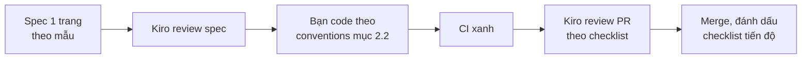
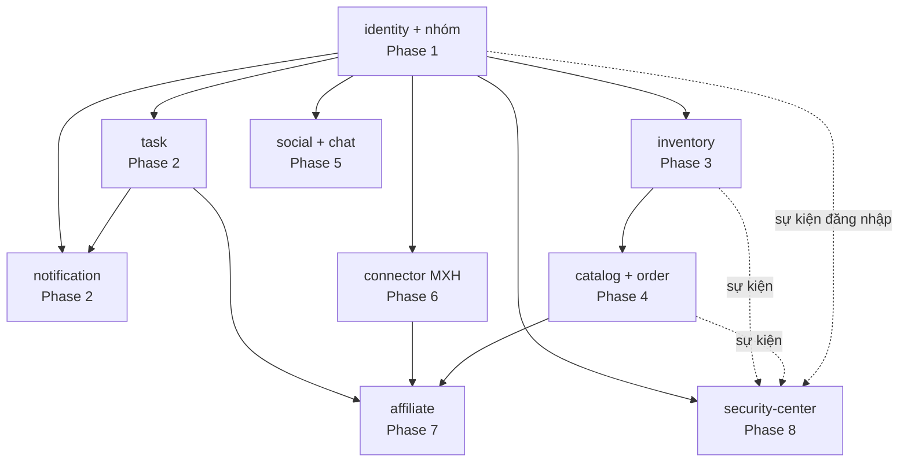
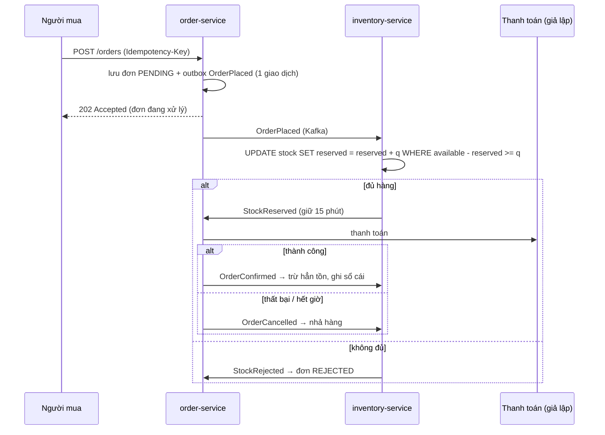

# Kế hoạch phát triển tech-forge

Trạng thái: **ĐÃ DUYỆT (bản 3)**. Phase 0 xong; tiếp theo Phase 1. Cập nhật: 2026-11-18. Cơ sở: mã nguồn tại commit `a6523af`, `docs/thiet-ke-platform-starter.md` (bản 3, đã làm M0–M8) và ghi chú của chủ dự án (Phụ lục C).

## 0. Bản 3 thay đổi gì

| Ghi chú của bạn | Thay đổi |
|---|---|
| Đa tenant không hợp mục đích và phạm vi | **Bỏ khỏi kế hoạch.** Chỉ giữ một đoạn đánh giá ở Phụ lục A làm tài liệu tham khảo |
| Hệ phải chịu được nhiều người dùng, đơn hàng dồn dập, giữ đúng tồn kho / đã bán | Nợ kỹ thuật được đánh giá lại theo bối cảnh này (mục 3) |
| Xếp nợ theo: bảo mật → chịu lỗi → chịu tải → vận hành, chia cấp | Mục 3 dùng đúng thứ tự đó, chia 3 cấp |
| Cần checklist đặt tên và luồng nghiệp vụ, dùng được làm tài liệu review | `docs/conventions.md` (trước là mục 5 và 6) |
| Gợi ý design pattern cho 6 nhóm sản phẩm | Mục 7 |
| Phase đầu sau thiết kế là sửa nợ; sản phẩm xếp theo độ phức tạp tăng dần | Lộ trình mới ở mục 8 |
| Bạn là người triển khai chính; Kiro thiết kế khung, checklist, hỗ trợ sửa lỗi | Cách làm việc ở mục 2 |

Các quyết định khác của bản 2 vẫn giữ: k3s do DevOps lo (ứng dụng chỉ cam kết hợp đồng triển khai); discovery hai chế độ; bí mật chỉ qua biến môi trường/file; GitHub Actions; Java 17; tự làm đăng nhập theo chuẩn; đa ngôn ngữ mặc định tiếng Anh (Phụ lục B).

---

## 1. Tổng quan

### 1.1 Mục đích

Rèn kỹ thuật lập trình bằng một sản phẩm **dùng được thật**, không chỉ là bản thiết kế. Repo public, làm tư liệu nghề nghiệp.

### 1.2 Người dùng và phạm vi

Một nhóm nhỏ. Bạn là quản trị viên, giao quyền cho từng nhóm nhân viên hoặc cộng sự, cùng làm việc và trao đổi riêng trong nền tảng.

| Vai trò của bạn | Cần gì từ nền tảng |
|---|---|
| Quản trị nền tảng | Tạo nhóm, mời người, giao quyền, xem nhật ký |
| Chủ trang trại | Quản lý xuất nhập kho, theo dõi an ninh khu vực |
| Admin page mạng xã hội, KOL | Gom nhiều tài khoản MXH về một chỗ, lên lịch đăng, giao việc affiliate, theo dõi kết quả |
| Người bán | Gian hàng, đơn hàng, tồn kho không bị bán âm |
| Thành viên nhóm | Nhận việc, trao đổi trong nhóm, nhận thông báo |

Độ phức tạp tăng dần theo **nhu cầu thật**, không thêm nghiệp vụ cho có.

### 1.3 Bảy sản phẩm, xếp theo độ phức tạp tăng dần

Sáu nhóm bạn nêu, trong đó "job/task liên kết affiliate" được tách làm hai: quản lý công việc (nền, đơn giản nhất) và affiliate (ghép nhiều sản phẩm, phức tạp).

| Bậc | Sản phẩm | Kỹ thuật chính được rèn |
|---|---|---|
| 1 | Quản lý công việc (task) | CRUD đúng chuẩn, máy trạng thái, phân quyền theo nhóm, sự kiện đầu tiên |
| 2 | Xuất nhập kho thu gọn | Sổ cái tồn kho, cập nhật đồng thời, idempotency |
| 3 | Gian hàng điện tử | Đặt chỗ tồn kho, chống bán âm khi dồn đơn, saga, outbox |
| 4 | Mạng xã hội thu nhỏ | Feed, đếm số, chat thời gian thực, cache, phân trang theo con trỏ |
| 5 | Kết nối và tập trung MXH | Adapter cho API ngoài, OAuth với bên thứ ba, giới hạn tốc độ, lịch chạy |
| 6 | Job affiliate liên kết MXH | Ghép task + MXH + đơn hàng: theo dõi click, quy đổi, tính hoa hồng |
| 7 | Trung tâm an ninh kết hợp | Gom sự kiện an ninh (đăng nhập bất thường, nhật ký, cảm biến/camera trang trại), luật cảnh báo |

Sản phẩm 7 "trình quản lý an ninh kết hợp" là "trung tâm an ninh": gom và cảnh báo sự kiện an ninh của cả hệ thống lẫn trang trại (đã xác nhận, ADR-0013).

---

## 2. Cách làm việc

| Ai | Làm gì |
|---|---|
| **Bạn** | Triển khai chính theo checklist; viết spec ngắn cho mỗi tính năng (mẫu ở `docs/templates/`); mở PR |
| **Kiro** | Thiết kế khung, quy ước, checklist, mẫu; review PR theo `docs/conventions.md` mục 2.3; gợi ý cách làm; hỗ trợ sửa lỗi |

Vòng làm một tính năng:

Quy tắc giữ nguyên: commit nhỏ, baseline test trước khi sửa, bạn tự push.

---

## 3. Đánh giá nợ kỹ thuật

Bối cảnh đánh giá: hệ có thể tăng người dùng, có lúc nhiều người truy cập cùng lúc, đơn hàng có thể dồn dập, **tồn kho và số đã bán phải luôn đúng**.

Thứ tự: **Bảo mật (S) → Chịu lỗi (F) → Chịu tải (L) → Vận hành (O)**.

| Cấp | Nghĩa | Khi nào phải xong |
|---|---|---|
| **1** | Chặn: thiếu thì hệ không dùng được, hoặc dùng được nhưng sai/không an toàn | Phase 1, trước sản phẩm đầu tiên |
| **2** | Trước khi có người dùng thật hoặc tải lớn | Cùng sản phẩm đầu tiên cần nó |
| **3** | Cải tiến | Khi số đo cho thấy cần |

**Nguyên tắc "làm khi cần":** nợ cấp 2 và 3 gắn với sản phẩm cần nó (cột "Gắn với"), không làm trước cho có.

### 3.1 Bảo mật (S)

| Mã | Nợ | Cấp | Gắn với |
|---|---|---|---|
| S1 | Chưa có đăng nhập, chưa phát JWT, chưa JWKS: mọi API trả 401 | 1 | Phase 1 |
| S2 | Gateway trống: chưa xác thực, **chưa xóa `X-User-Id` do client gửi** | 1 | Phase 1 |
| S3 | Chưa có quản trị viên đầu tiên; chưa có API quản trị người dùng, nhóm, quyền | 1 | Phase 1 |
| S4 | Chưa giới hạn tốc độ: dò mật khẩu, spam đơn hàng | 1 | Phase 1 (đăng nhập), Phase 4 (đơn) |
| S5 | Chưa quét lỗ hổng dependency, chưa quét bí mật; repo public | 1 | Phase 1 |
| S6 | Mỗi service chưa có user DB riêng quyền tối thiểu; Redis chưa đặt mật khẩu/ACL | 2 | Phase 2 |
| S7 | CORS, header bảo mật, giới hạn kích thước body ở gateway | 2 | Phase 2 |
| S8 | OAuth token của MXH bên ngoài phải mã hóa khi lưu | 2 | Phase 6 |
| S9 | MFA cho quản trị viên | 3 | Phase 8 |

### 3.2 Chịu lỗi (F)

| Mã | Nợ | Cấp | Gắn với |
|---|---|---|---|
| F1 | Chưa có outbox: ghi DB xong, gửi sự kiện lỗi là **mất sự kiện** | 1 | Phase 2 (sự kiện đầu tiên) |
| F2 | Chưa có consumer idempotent: Kafka giao "ít nhất một lần", **xử lý trùng** | 1 | Phase 2 |
| F3 | API tạo chưa có idempotency key: client gửi lại thì **tạo trùng đơn** | 1 | Phase 2 (task), bắt buộc ở Phase 4 |
| F4 | Circuit breaker tắt mặc định; chưa có chính sách retry | 2 | Phase 3 |
| F5 | Redis chết thì mọi kiểm quyền thất bại (fail-closed) | 2 | Phase 3 |
| F6 | Chưa có DLQ và cách xử lý tin lỗi | 2 | Phase 2 |
| F7 | Saga cho đặt hàng (giữ hàng → thanh toán → xác nhận, có bước bù) | 2 | Phase 4 |
| F8 | Gọi API MXH ngoài: hết hạn token, lỗi tạm thời, quota | 2 | Phase 6 |

### 3.3 Chịu tải (L)

| Mã | Nợ | Cấp | Gắn với |
|---|---|---|---|
| L1 | **Bán âm khi dồn đơn:** chưa có cơ chế trừ tồn nguyên tử | 1 | Phase 3 (kho), Phase 4 (đơn) |
| L2 | Đơn dồn dập làm nghẽn DB: chưa có hàng đợi san tải | 2 | Phase 4 |
| L3 | SKU "nóng" (nhiều người mua một món): tranh khóa một dòng | 2 | Phase 4 |
| L4 | Mỗi request kiểm quyền thêm một lần đọc Redis | 2 | Phase 5 (đo trước) |
| L5 | Phân trang offset chậm khi dữ liệu lớn (feed, lịch sử kho) | 2 | Phase 3, Phase 5 |
| L6 | Chưa tinh chỉnh pool kết nối DB, chỉ mục | 2 | Theo từng sản phẩm |
| L7 | Chưa có số liệu hiệu năng gốc và kiểm thử tải | 2 | Phase 4 |
| L8 | Feed MXH: tính lúc đọc hay đẩy sẵn | 3 | Phase 5 |

### 3.4 Vận hành (O)

| Mã | Nợ | Cấp | Gắn với |
|---|---|---|---|
| O1 | Chưa có CI, chưa có Maven Wrapper, chưa có README | 1 | Phase 1 |
| O2 | Chưa có Docker Compose để chạy cả hệ trên máy | 1 | Phase 1 |
| O3 | `${revision}` không có flatten; `.mvn/maven.config` lệch pom | 1 | Phase 1 |
| O4 | `identity_service.proto` rỗng, sai `java_package`; `IamSchemaIT` đã xóa (đang stage) | 1 | Phase 1 |
| O5 | `docker.registry` tạm; chưa đẩy image lên GHCR | 2 | Phase 2 |
| O6 | Chưa có dashboard, cảnh báo (tỉ lệ lỗi, độ trễ, tồn kho âm, DLQ) | 2 | Phase 3 |
| O7 | Chưa có hợp đồng triển khai và manifest mẫu k3s | 2 | Phase 4 |
| O8 | Chưa kiểm `.proto`/OpenAPI phá vỡ tương thích | 2 | Phase 3 |
| O9 | Chưa có mẫu tạo service mới | 2 | Phase 2 |

### 3.5 Phần đã làm cần tinh giản

| Hạng mục | Đánh giá | Đề xuất |
|---|---|---|
| `notification-service` | Cần cho thông báo nội bộ | Giữ |
| `order-service` | Sẽ thành service đơn hàng của gian hàng | Giữ, đổi tên khi tới Phase 4 nếu cần |
| `shared-event` | Rỗng | Dùng cho envelope ở Phase 2 |
| `UserSessionEntity`, `UserTokenEntity` | Mới có trường tối thiểu | Chốt ở Phase 1 cùng đăng nhập |
| Mọi thứ liên quan tenant | Chưa từng được code | Không làm; chỉ Phụ lục A |

---

## 4. Bản đồ module và phụ thuộc

### 4.1 Service đề xuất (thêm dần theo phase)

| Service | Sở hữu dữ liệu | Thêm ở phase |
|---|---|---|
| `identity-service` | Người dùng, nhóm (workspace), thành viên, role, quyền, phiên | Có sẵn; nhóm thêm ở Phase 1 |
| `notification-service` | Thông báo trong ứng dụng, hàng đợi gửi | Có sẵn; dùng thật ở Phase 2 |
| `task-service` | Dự án, task, bình luận task | Phase 2 |
| `inventory-service` | Kho, mặt hàng, sổ cái nhập/xuất, số tồn | Phase 3 |
| `catalog-service` | Sản phẩm, giá, ảnh (đọc nhiều) | Phase 4 |
| `order-service` | Giỏ, đơn, trạng thái đơn, saga | Phase 4 |
| `social-service` | Bài viết, bình luận, cảm xúc, theo dõi, feed | Phase 5 |
| `chat-service` | Hội thoại nhóm/riêng, tin nhắn (WebSocket) | Phase 5 |
| `connector-service` | Tài khoản MXH ngoài, lịch đăng, gom hộp thư/số liệu | Phase 6 |
| `affiliate-service` | Chiến dịch, link theo dõi, quy đổi, hoa hồng | Phase 7 |
| `security-center` | Sự kiện an ninh, luật, cảnh báo, thiết bị | Phase 8 |

Quy tắc: mỗi service một DB riêng; không đọc DB của nhau; nói chuyện qua REST/gRPC (đồng bộ) hoặc sự kiện (bất đồng bộ).

### 4.2 Phụ thuộc giữa sản phẩm

---

## 5. Quy ước đặt tên và khai báo

Đã chuyển sang `docs/conventions.md` mục 1 (tài liệu sống, dùng khi review).

## 6. Luồng nghiệp vụ chuẩn và checklist review

Đã chuyển sang `docs/conventions.md` mục 2. Checklist review cũng có trong `.github/pull_request_template.md`.

---

## 7. Design pattern gợi ý cho từng sản phẩm

### 7.1 Pattern dùng chung

| Pattern | Dùng khi | Ở đâu trong khung |
|---|---|---|
| Layered / Hexagonal (cổng và adapter) | Mọi service | Cây gói, ArchUnit |
| Aggregate + Domain Event (DDD) | Mọi thay đổi trạng thái có luật | `domain.model`, `domain.event` |
| Transactional Outbox | Ghi DB và phát sự kiện | `jpa-starter` (Phase 2) |
| Idempotent Consumer | Nhận sự kiện | `kafka-starter` (Phase 2) |
| Idempotency Key | API tạo | `web-starter` (Phase 2) |
| Optimistic Lock (`@Version`) | Tranh chấp thấp | Đã có trong `BaseEntity` |
| Cập nhật có điều kiện (`UPDATE ... WHERE available >= ?`) | Tranh chấp cao, trừ số | Kho, đơn (Phase 3–4) |
| Saga (orchestration) | Luồng nhiều service có bước bù | Đơn hàng (Phase 4) |
| CQRS (mô hình đọc riêng) | Đọc nhiều, ghi ít, hoặc dạng đọc khác dạng ghi | Feed, catalog, báo cáo |
| Circuit Breaker, Timeout, Bulkhead | Gọi service/API ngoài | `feign-starter`, `grpc-starter` |
| Rate Limiter (token bucket) | Đăng nhập, đặt đơn, gọi API ngoài | Gateway, connector |

### 7.2 Theo sản phẩm

| Sản phẩm | Bài toán | Pattern | Ghi chú |
|---|---|---|---|
| **1. Task** | Trạng thái task (mới → đang làm → xong/hủy), giao việc, thông báo | **State Machine** (enum + bảng chuyển hợp lệ trong domain), Domain Event (`TaskAssigned`) → notification, Specification (lọc) | Không dùng thư viện state machine; enum đủ và dễ đọc |
| **2. Kho** | Nhập, xuất, chuyển kho, kiểm kê; tồn luôn đúng | **Ledger / Event-sourced balance** (sổ cái chỉ thêm, số tồn = tổng), cập nhật có điều kiện, Idempotency Key, Snapshot (số tồn tính sẵn, đối soát định kỳ) | Không bao giờ sửa dòng sổ cái; sai thì thêm dòng điều chỉnh |
| **3. Gian hàng** | Dồn đơn, không bán âm, thanh toán có thể lỗi | **Reservation** (giữ hàng có hạn), **Saga** (giữ hàng → thanh toán → xác nhận; lỗi thì nhả hàng), **Queue-based Load Leveling** (nhận đơn nhanh, xử lý sau), Outbox, CQRS cho catalog, Cache-aside cho sản phẩm | Xem 7.3 |
| **4. MXH thu nhỏ** | Feed, đếm like, chat nhóm riêng | **Fan-out on read** (nhóm nhỏ, đơn giản) → chuyển **fan-out on write** khi cần (L8), **Counter** gộp ghi (Redis tăng, ghi DB theo lô), **Cursor pagination**, **Pub/Sub** cho chat (WebSocket + Redis) | Chat tách service vì kết nối dài |
| **5. Kết nối MXH** | Nhiều MXH, mỗi cái một API khác | **Adapter** (mỗi MXH một adapter, chung một cổng `SocialPlatformPort`), **Strategy** (cách đăng theo nền tảng), **Anti-corruption Layer**, Scheduler + Outbox cho bài hẹn giờ, Rate Limiter theo quota từng nền tảng, Retry có backoff | Token OAuth của bên ngoài mã hóa khi lưu (S8) |
| **6. Affiliate** | Giao việc quảng bá, theo dõi click, ghi nhận đơn, tính hoa hồng | **Saga/Process Manager** (chiến dịch → task → bài đăng → click → đơn → hoa hồng), **Ledger** cho hoa hồng, **Rules/Strategy** cho cách tính, Idempotent Consumer (sự kiện đơn), link theo dõi có chữ ký (chống giả) | Ghép lại task + connector + order, nên làm sau cùng trong nhóm thương mại |
| **7. Trung tâm an ninh** | Gom sự kiện từ nhiều nguồn, phát hiện bất thường, cảnh báo | **Event Stream Processing** (đọc nhiều topic), **Rules Engine** đơn giản (luật cấu hình được), **Sliding Window** (5 lần đăng nhập sai trong 1 phút), **Observer** cho kênh cảnh báo, Append-only cho nhật ký | Thiết bị trang trại (cảm biến, camera) nối qua MQTT hoặc webhook |

### 7.3 Ví dụ: chống bán âm khi dồn đơn (sản phẩm 3)

| Điểm | Vì sao |
|---|---|
| Trả `202` ngay | Đơn dồn dập không làm treo người dùng (san tải) |
| Trừ bằng `UPDATE ... WHERE` | Một câu lệnh nguyên tử, không cần khóa phía ứng dụng, không bán âm |
| Giữ hàng có hạn | Thanh toán treo không giữ hàng mãi |
| Mọi bước qua outbox + consumer idempotent | Không mất, không trùng |
| Kiểm bắt buộc | Test logic quyết định giữ hàng; trên Compose: 100 đơn cùng lúc cho 10 món còn lại → đúng 10 đơn thành công, tồn = 0, không âm |

---

## 8. Lộ trình theo Phase

| Phase | Tên | Kết quả dùng được thật |
|---|---|---|
| 0 | Thiết kế và khung khai báo | Quy ước, mẫu spec, mẫu service; tài liệu này được duyệt |
| 1 | **Sửa nợ cấp 1 và tinh chỉnh nền** | Đăng nhập được qua gateway; CI xanh; chạy cả hệ trên máy |
| 2 | Sản phẩm 1: Quản lý công việc | Bạn giao việc cho nhóm, nhận thông báo |
| 3 | Sản phẩm 2: Xuất nhập kho | Quản lý kho trang trại, tồn luôn đúng |
| 4 | Sản phẩm 3: Gian hàng | Bán hàng, dồn đơn không bán âm |
| 5 | Sản phẩm 4: MXH thu nhỏ + chat | Nhóm đăng bài, trao đổi riêng |
| 6 | Sản phẩm 5: Kết nối MXH | Quản lý nhiều page/kênh ở một chỗ |
| 7 | Sản phẩm 6: Affiliate | Giao việc quảng bá, tính hoa hồng |
| 8 | Sản phẩm 7: Trung tâm an ninh | Cảnh báo đăng nhập bất thường, cảm biến trang trại |

Mỗi phase sản phẩm có **MVP** (bản nhỏ nhất dùng được) trước, mở rộng sau.

### Phase 0: Thiết kế và khung khai báo

| Mã | Việc | Xong khi |
|---|---|---|
| 0.1 | Duyệt tài liệu này | Bạn duyệt |
| 0.2 | Mẫu `docs/templates/feature-spec.md` (spec 1 trang: mục tiêu, người dùng, luồng, quyền, lỗi, sự kiện, dữ liệu, test) | Có mẫu và một ví dụ điền sẵn |
| 0.3 | Mẫu `docs/templates/adr.md` và ADR cho các quyết định ở Phụ lục B | `docs/adr/` có đủ |
| 0.4 | Mẫu `.github/pull_request_template.md` chứa checklist review | PR mới hiện checklist |
| 0.5 | Chuyển mục 5 và 6 thành `docs/conventions.md` (tài liệu sống, dùng khi review) | Có file, link từ `docs/README.md` (README gốc làm ở 1.1) |

### Phase 1: Sửa nợ cấp 1 và tinh chỉnh nền

Thứ tự theo S → F → L → O, trừ các việc O rẻ mà mọi việc khác cần (1.1–1.3) làm đầu tiên.

| Mã | Việc | Nợ | Xong khi |
|---|---|---|---|
| 1.1 | Maven Wrapper, README tiếng Anh (kèm tiếng Việt), LICENSE, `.editorconfig`; sửa version (`${revision}`) | O1, O3 | `./mvnw verify` chạy trên máy sạch |
| 1.2 | GitHub Actions: build, test (không container, ADR-0014), JaCoCo; CodeQL, Dependabot, gitleaks | O1, S5 | PR đỏ khi test đỏ hoặc lộ bí mật |
| 1.3 | Docker Compose: PostgreSQL, Redis, Kafka, Consul, Jaeger, Prometheus | O2 | `docker compose up`, mọi container healthy |
| 1.4 | Dọn: proto rỗng, `IamSchemaIT` | O4 | Không còn file thừa |
| 1.5 | Thiết kế đăng nhập (tài liệu duyệt trước): JWT RS256, JWKS, refresh xoay vòng, khóa tạm | S1 | Tài liệu được duyệt |
| 1.6 | Đăng nhập, JWT, JWKS, refresh, logout | S1 | Test logic từng luồng và từng tấn công đã biết; trên Compose: login → gọi API → 200 |
| 1.7 | Quản trị viên đầu tiên; **nhóm (workspace)**: tạo nhóm, mời thành viên, role trong nhóm | S3 | Test use case; trên Compose: admin tạo nhóm, giao quyền, thành viên dùng được |
| 1.8 | `webflux-starter` + gateway: JWT, **xóa header nội bộ**, định tuyến qua discovery, rate limit đăng nhập | S2, S4 | Test filter: `X-User-Id` giả bị xóa; trên Compose: dò mật khẩu bị 429 |
| 1.9 | Discovery hai chế độ (tĩnh/Consul ở dev, DNS ở k3s) | | Cùng mã chạy cả hai chế độ |
| 1.10 | i18n thông điệp lỗi, mặc định `en` | | `Accept-Language: vi` ra tiếng Việt |
| 1.11 | Mẫu tạo service (archetype) | O9 | Service mới build xanh dưới 10 phút |

Kết thúc Phase 1: **MS-1 "Nền dùng được"**: đăng nhập qua gateway, tạo nhóm, giao quyền, CI xanh.

### Phase 2: Quản lý công việc (sản phẩm 1)

| Mã | Việc | Nợ đi kèm | Xong khi |
|---|---|---|---|
| 2.1 | Spec task-service | | Spec được duyệt |
| 2.2 | Envelope sự kiện, `kafka-starter`, **outbox**, **consumer idempotent**, DLQ | F1, F2, F6 | Test logic: trùng `eventId` không xử lý hai lần; trên Compose: rollback không phát, Kafka chết rồi sống thì gửi lại |
| 2.3 | Idempotency key cho API tạo | F3 | Gửi hai lần ra một task |
| 2.4 | Task MVP: dự án, task, giao việc, máy trạng thái, bình luận | | Bạn dùng hằng ngày được |
| 2.5 | Thông báo trong ứng dụng khi được giao việc | | Thành viên thấy thông báo |
| 2.6 | Image lên GHCR | O5 | Image có tag theo commit |

**MS-2:** task dùng thật, sự kiện tin cậy.

### Phase 3: Xuất nhập kho (sản phẩm 2)

| Mã | Việc | Nợ đi kèm | Xong khi |
|---|---|---|---|
| 3.1 | Spec inventory-service | | Duyệt |
| 3.2 | Kho, mặt hàng, sổ cái nhập/xuất/điều chỉnh (chỉ thêm) | | Tồn = tổng sổ cái |
| 3.3 | Trừ tồn nguyên tử, idempotency | L1 | Test logic: không đủ tồn thì từ chối; trên Compose: 100 request cùng lúc, tồn không âm |
| 3.4 | Lịch sử phân trang theo con trỏ (`CursorResponse` trong `api-model`) | L5 | Truy vấn nhanh khi 1 triệu dòng (đo) |
| 3.5 | Circuit breaker, retry, dự phòng khi Redis chết | F4, F5 | Tắt Redis: lỗi rõ ràng, phục hồi tự động |
| 3.6 | Dashboard, cảnh báo cơ bản; kiểm hợp đồng phá vỡ trong CI | O6, O8 | Cảnh báo khi tồn sắp hết, khi lỗi tăng |

**MS-3:** kho trang trại dùng thật, tồn đúng dưới tải.

### Phase 4: Gian hàng (sản phẩm 3)

| Mã | Việc | Nợ đi kèm | Xong khi |
|---|---|---|---|
| 4.1 | Spec catalog + order | | Duyệt |
| 4.2 | Catalog (CQRS đọc, cache) | | Trang sản phẩm đọc từ cache |
| 4.3 | Đặt hàng: giữ hàng, saga, thanh toán giả lập, hết hạn giữ | F7, L1 | Luồng 7.3 chạy đủ nhánh |
| 4.4 | San tải đơn (202 + hàng đợi), rate limit đặt đơn | L2, S4 | Đơn dồn không làm treo API |
| 4.5 | SKU nóng | L3 | Kiểm thử tải trên Compose: 1 SKU, 500 đơn/giây, không âm |
| 4.6 | Kiểm thử tải, số liệu gốc | L7 | Báo cáo p95, thông lượng |
| 4.7 | Hợp đồng triển khai, manifest mẫu k3s | O7 | Một service chạy trên k3s |

**MS-4:** bán hàng thật, dồn đơn không sai số.

### Phase 5 – 8

Chi tiết từng phase viết khi tới gần (theo nguyên tắc "làm khi cần"). Đầu việc khung:

| Phase | MVP | Nợ / kỹ thuật mới |
|---|---|---|
| 5 MXH + chat | Bài viết, bình luận, cảm xúc trong nhóm; chat nhóm WebSocket | L4 (đo, có thể thêm cache L1 quyền), L5, L8, Counter, Pub/Sub |
| 6 Kết nối MXH | Kết nối 1 nền tảng trước (ví dụ Facebook Page), lên lịch đăng, xem số liệu | S8, F8, Adapter, Rate Limiter theo quota |
| 7 Affiliate | Chiến dịch → task → link theo dõi → ghi nhận đơn → hoa hồng | Process Manager, Ledger hoa hồng, link có chữ ký |
| 8 Trung tâm an ninh | Đăng nhập bất thường, nhật ký tập trung, cảnh báo; thêm cảm biến trang trại | Stream processing, luật, MFA (S9) |

---

## 9. Checklist tiến độ

Đánh dấu `[x]` khi đạt "Xong khi" (có test hoặc bằng chứng), không phải khi viết xong mã.

### Phase 0
- [x] 0.1 Duyệt kế hoạch
- [x] 0.2 Mẫu spec tính năng
- [x] 0.3 Mẫu ADR + ADR
- [x] 0.4 Mẫu PR có checklist review
- [x] 0.5 `docs/conventions.md`

### Phase 1
- [ ] 1.1 Wrapper, README, version
- [ ] 1.2 GitHub Actions + bảo mật CI
- [ ] 1.3 Docker Compose
- [ ] 1.4 Dọn file thừa
- [ ] 1.5 Thiết kế đăng nhập
- [ ] 1.6 Đăng nhập, JWT, JWKS
- [ ] 1.7 Quản trị viên đầu tiên, nhóm
- [ ] 1.8 Gateway
- [ ] 1.9 Discovery
- [ ] 1.10 i18n
- [ ] 1.11 Mẫu tạo service

### Phase 2
- [ ] 2.1 Spec task
- [ ] 2.2 Sự kiện tin cậy (outbox, idempotent, DLQ)
- [ ] 2.3 Idempotency key
- [ ] 2.4 Task MVP
- [ ] 2.5 Thông báo
- [ ] 2.6 Image GHCR

### Phase 3
- [ ] 3.1 Spec kho
- [ ] 3.2 Sổ cái
- [ ] 3.3 Trừ tồn nguyên tử
- [ ] 3.4 Phân trang con trỏ
- [ ] 3.5 Chịu lỗi
- [ ] 3.6 Dashboard, kiểm hợp đồng

### Phase 4
- [ ] 4.1 Spec gian hàng
- [ ] 4.2 Catalog
- [ ] 4.3 Đặt hàng, saga
- [ ] 4.4 San tải đơn
- [ ] 4.5 SKU nóng
- [ ] 4.6 Kiểm thử tải
- [ ] 4.7 Triển khai k3s

### Phase 5–8
- [ ] 5 MXH + chat MVP
- [ ] 6 Kết nối MXH MVP
- [ ] 7 Affiliate MVP
- [ ] 8 Trung tâm an ninh MVP

---

## 10. Mốc quan trọng

| Mốc | Ý nghĩa | Kiểm bằng |
|---|---|---|
| **MS-0** | Có quy ước và mẫu để tự làm không lạc | `docs/conventions.md`, mẫu spec, mẫu PR |
| **MS-1** | Nền dùng được: đăng nhập qua gateway, nhóm, quyền, CI | Chạy luồng đầu-cuối qua gateway trên Compose |
| **MS-2** | Sản phẩm đầu tiên dùng hằng ngày; sự kiện tin cậy | Bạn dùng task-service một tuần |
| **MS-3** | Tồn kho đúng dưới tải | 100 request cùng lúc trên Compose |
| **MS-4** | Bán hàng thật, dồn đơn không sai số | Kiểm thử tải + luồng saga đủ nhánh |
| **MS-5…8** | Từng sản phẩm còn lại | MVP mỗi phase |

### Điều kiện bắt đầu một sản phẩm mới

- [ ] Phase trước đạt "Xong khi"
- [ ] Spec được duyệt
- [ ] Nợ "Gắn với" phase này đã có trong checklist
- [ ] Biết aggregate, quyền, mã lỗi, sự kiện, bảng (theo `docs/conventions.md` mục 1)

---

## 11. Đã xác nhận

Cả 4 điểm đã được chủ dự án xác nhận, ghi ở `docs/adr/0013-gia-dinh-pham-vi-san-pham.md` (Chấp nhận). Chiến lược test ghi ở ADR-0014.

1. **Sản phẩm 7 "trình quản lý an ninh kết hợp"**: có phải là trung tâm gom sự kiện an ninh của hệ thống (đăng nhập bất thường, nhật ký) **và** an ninh trang trại (cảm biến, camera, ra vào) không? có 
2. **Thứ tự sản phẩm** ở mục 1.3 có đúng ý không? Đặc biệt: kho (2) trước gian hàng (3), và MXH (4) trước kết nối MXH (5). đúng
3. **Nhóm (workspace)** đặt trong `identity-service` (Phase 1.7), không tách service riêng. Đồng ý? đồng ý
4. **Thanh toán** ở gian hàng: giả lập trước, nối cổng thật (VNPay/MoMo) sau. Đồng ý? đồng ý

---

## Phụ lục A. Đa tenant: đánh giá, không áp dụng

Đánh giá ở bản 2: mô hình cột `tenant_id` trong bảng chung, Hibernate `@TenantId`, tenant đi theo token.

Kết luận theo ghi chú của bạn: **không áp dụng**. Lý do:

1. Phạm vi là một nhóm nhỏ do một quản trị viên điều hành, không phải nhiều tổ chức độc lập.
2. Đa tenant thật trong thực tế thường dựa vào IdP như Keycloak (realm), không tự dựng từ đầu.
3. Thêm vào lúc này làm tăng công phát triển và duy trì ở mọi bảng, token, cache, sự kiện, mà không phục vụ nhu cầu nào hiện có.

Nhu cầu "chia theo nhóm" được đáp ứng bằng **nhóm (workspace) + role theo nhóm** trong identity (Phase 1.7), đơn giản hơn nhiều.

## Phụ lục B. Quyết định giữ từ bản 2

| # | Quyết định |
|---|---|
| Q2 | k3s tự dựng; cụm, chứng chỉ, kho bí mật là việc DevOps; ứng dụng cam kết hợp đồng triển khai và có manifest mẫu |
| Q3 | Discovery: mã gọi theo tên service; `local` danh sách tĩnh, `compose` Consul, k3s DNS |
| Q4 | Bí mật chỉ qua biến môi trường/file `/run/secrets`; dev `.env` (không commit); CI GitHub Secrets; k3s Sealed Secrets, sau có thể đổi sang Vault mà không sửa mã |
| Q5 | GitHub Actions, CodeQL, Dependabot, gitleaks, GHCR; README tiếng Anh |
| Q6 | Java 17 |
| Q7 | Tự làm đăng nhập theo chuẩn (RS256, JWKS, claim chuẩn); không tự viết thuật toán mã hóa; đổi sang Keycloak về sau không phải sửa service |
| Q8 | Đa ngôn ngữ, mặc định tiếng Anh; chỉ dịch ở biên REST, giữa service chỉ truyền mã lỗi |

## Phụ lục C. Ghi chú gốc của chủ dự án

Giữ nguyên văn để đối chiếu khi review.

> - tôi đánh giá thiết kế tenant là không phù hợp với mong muốn của dự án của tôi, có thể đưa vào kiến trúc nghiên cứu nhưng thực tại thì rất ít bên sẽ phát triển phần này từ đầu nên tôi đánh giá là không cần thiết vì trong dự án thực có lẽ sẽ sử dụng keycloak cho đầy đủ và chuyên nghiệp hơn nên việc thiết kế này chỉ dừng lại ở phâir tài liệu tham khảo và đánh giá dự án không phù hợp với thiết kế đos cho mục đích và phạm vi sử dụng hiện tại không thêm vào làm gì để tốn thêm công cho việc phát triển và duy trì, không phức tạp một cách lệch lạc
> - các phần thiết kế và nợ công nghệ nên được đánh giá là đây là một dự án theo dạng vận hành có thể tăng lượng người dùng lên, có thể có nhiều người dùng truy cập trong 1 khoảng thời gian nhất định, các đơn hảng có thể tới dồn dập và đáp ứng được bài toàn bảo toàn số lượng tồn kho / đã bán
> - tinh giản các phần thừa thãi liên quan tới tenant vì nó không cần thiết
> - nợ công nghệ ở đây tôi đánh giá theo quy chuẩn: độ bảo mật -> khả năng chịu lỗi -> khả năng chịu tải -> khả năng vận hành chia cấp độ hợp lý đây chỉ là gợi ý
> - các phần thiết kế còn lại thì nên thiết kế theo một khía cạnh - tạo checklist cho việc khai báo đặt tên và flow nghiêp vụ hoặc logic cần đi theo -> để đây không chỉ là URD phát triển mà còn là tài liệu IT cho việc review -> làm mịn sau này
> - áp dụng và gợi ý các design pattern phù hợp cho từng nghiệp vụ của một msa về gian hàng điện tử, một mxh thu nhỏ, một trình quản lý an ninh kết hợp, một trình thu gọn của quản lý xuất nhập kho, một trình quản lý job task cơ bản liên kết với công việc làm affilate cho các mxh, một công cụ hỗ trợ kết nối các mxh lại để tập trung
> - mục đích của dự án là rèn luyện kỹ thuật lập trình và ứng dụng kỹ thuật của mình vào việc thực tế có thể sử dụng được thật cho một lập trình viên thế hệ mới mà không chỉ là thiết kế khô khan nằm trên văn bản
> - phạm vi có thể sẽ là một nhóm nhỏ theo dạng tôi là admin giao quyền cho một hội nhóm nhân viên hoặc là cùng nhau làm việc gì đó và trao đổi riêng trong nền tảng này, và tôi cũng ko chỉ là lập trình viên mà tôi có thể là admin của trang trại, admin của các page mxh, là một kol cần có một công cụ quản lý, sẽ tăng cường nhu cầu về từng nghiệp vụ riêng biệt này để tăng độ phức tạp cho dự án từng ngày sử dụng mà không phải là khai báo nghiệp vụ bừa bãi
> - yêu cầu hiện tại - tinh chỉnh lại kế hoạch phát triển theo hướng mà tôi mong muốn phase đầu tiên sau mục thiết kế là sửa nợ tồn đọng và tinh chỉnh thiết kế theo mong muốn phức tạp dần, làm và sắp đặt các mong muốn về sản phẩm bên trên theo độ phức tạp tăng dần để phát triển và lên lộ trình phát triển
> - vẫn giữ mong muốn bạn thiết kế cho tôi và tạo một bộ khung khai báo, chỉ quản lý và hỗ trợ fix lỗi hoặc gợi ý triển khai, tôi sẽ là người triển khai chính theo checklist mà bạn thiết kế sẵn để tôi không lạc trong ma trận mà mình muốn làm
