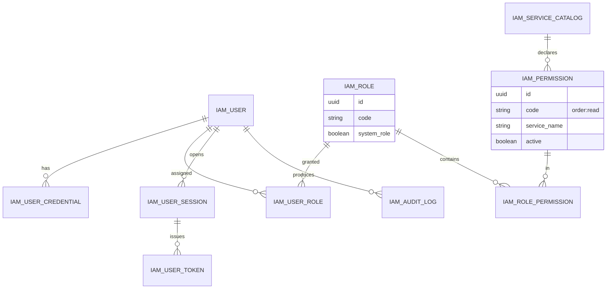
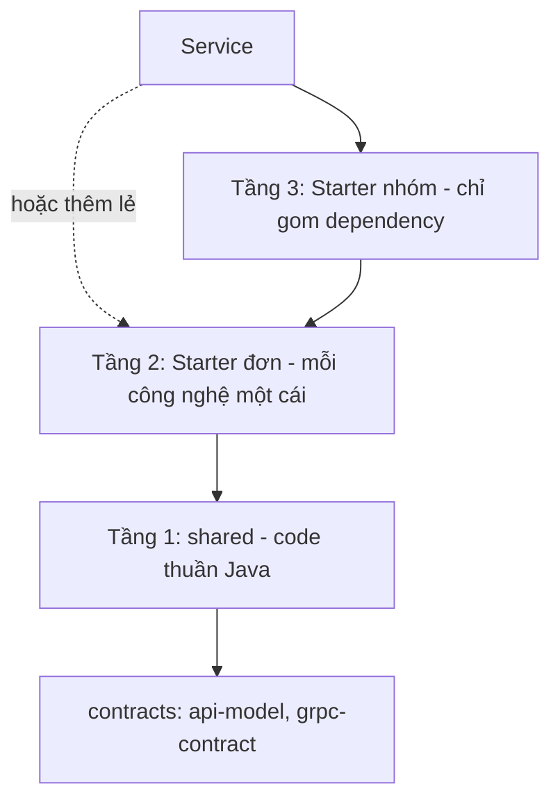
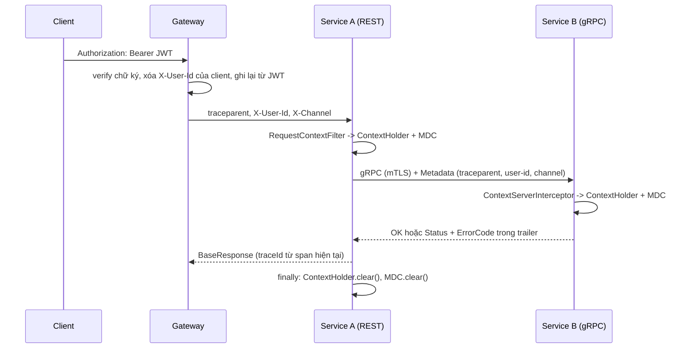
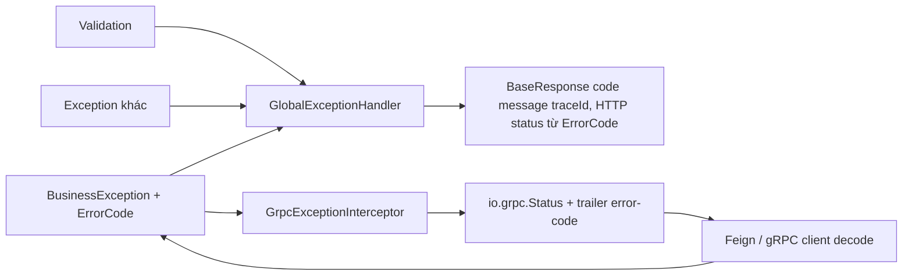
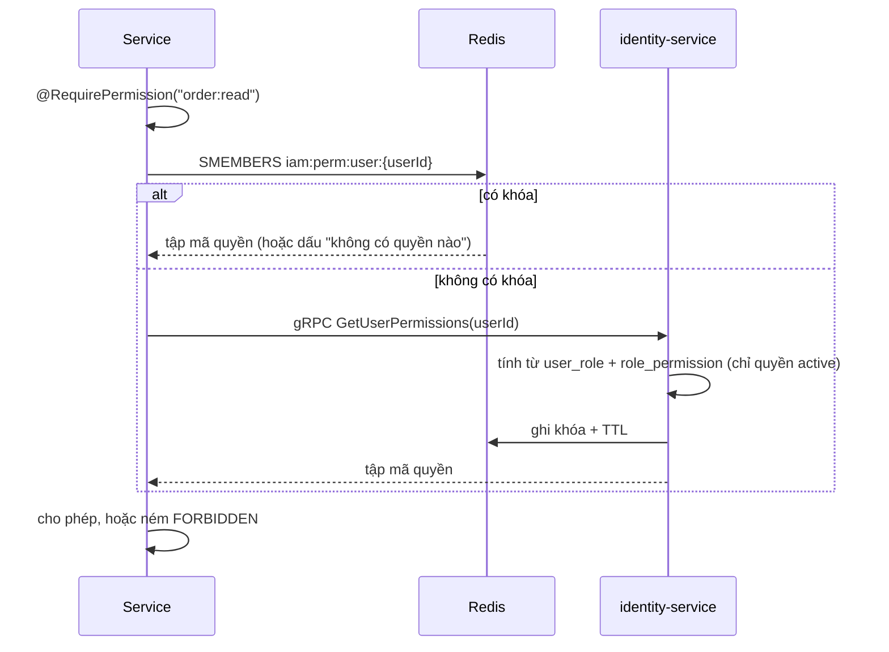

# Thiết kế: Kho starter theo nhóm và rà soát identity-service

Trạng thái: **ĐÃ DUYỆT (bản 3)**. Đã làm M0 đến M8.

## 0. Thay đổi so với bản 2

Bản 3 là bản **duyệt lần cuối**. Mọi mục "cần xác nhận" ở bản 2 đã có câu trả lời của bạn (xem mục 7). Các thay đổi:

| Bản 2 | Bản 3 |
|---|---|
| Đồng bộ danh mục quyền tự động để "làm sau" | **Đưa vào kế hoạch chính** (mốc M6), thiết kế đầy đủ ở 3.5: giao thức, bảng, quy tắc vô hiệu hóa, bảo mật, lỗi |
| Seed quyền bằng Flyway là bước chính | Flyway chỉ còn seed khởi tạo (role `SUPER_ADMIN`, quyền riêng của identity) |
| `security-starter` gọi thẳng Redis và gRPC | Tách thành giao diện (SPI) ở `shared-auth`. Cài đặt Redis nằm ở `cached-starter`, cài đặt gRPC ở `grpc-starter`. Giữ đúng luật "starter đơn không phụ thuộc starter đơn" |
| `order-service` dùng `service-starter-jpa-grpc-feign` | Đổi thành `service-starter-jpa-cache-grpc-feign` (lý do ở 2.3; **cần bạn duyệt lại**) |
| Phong bì lỗi chưa chốt | Chốt: `BaseResponse` cho cả lỗi |
| `shared-persistence` có thể để riêng | Chốt: gộp vào `jpa-starter` |
| Kế hoạch 8 mốc (M0-M7) | 9 mốc (M0-M8), thêm M6 đồng bộ danh mục quyền |

Nền tảng từ bản 1 và 2 giữ nguyên: không có platform lớn, chia starter nhỏ rồi nhóm theo tổ hợp công nghệ, bỏ 5 bảng phân quyền, quyền tra từ cache theo `userId`, mã nguồn chưa đổi.

## 1. Rà soát hiện trạng

Mã nguồn chưa đổi từ bản 1 (đã kiểm: không có file nào mới hơn tài liệu).

### 1.1 Entity identity-service

| # | Vấn đề | Tác động | Đề xuất |
|---|---|---|---|
| 1 | 6 lớp thiếu `@Entity`, `@Table`, getter/setter: `UserSessionEntity`, `UserTokenEntity`, `GrpcPermissionEntity`, `PermissionScopeEntity`, `UserRoleAssignmentEntity`, `RestPermissionEntity` | Hibernate bỏ qua, không có bảng | Hoàn thiện `UserSession`, `UserToken`, `UserRoleAssignment`. Xóa `GrpcPermission`, `RestPermission`, `PermissionScope` (xem 1.3) |
| 2 | `RolePermissionEntity` không kế thừa `BaseEntity`, tự khai báo `@Id` không có generator | Không đồng nhất, id phải tự gán | Kế thừa `BaseEntity`, thêm unique `(role_id, permission_id)` |
| 3 | `AuditLogEntity` kế thừa `AuditableEntity` | Nhật ký chỉ được thêm, nhưng lại có `updated_at`, `version` | Lớp gốc `AppendOnlyEntity` (id, created_at), không setter |
| 4 | `@AllArgsConstructor` trên `UserEntity` | Cho phép đặt `id`, `version` tùy ý | Bỏ. Dùng `@NoArgsConstructor(access = PROTECTED)` + factory method |
| 5 | Không có `@Column` | Hibernate sinh `varchar(255)` nullable. SQL là nguồn chính nên phải khớp | Khai báo rõ độ dài, nullable, unique. Khớp migration |
| 6 | `LocalDateTime` ở credential và role assignment, base dùng `Instant` | `LocalDateTime` không có múi giờ | `Instant` (cột `timestamptz`) |
| 7 | `passwordVersion` kiểu `String` | Khó so sánh | `int` |
| 8 | Quan hệ chỉ bằng `UUID` | Hợp DDD, nhưng thiếu ràng buộc | Giữ `UUID`, thêm FOREIGN KEY trong SQL. Không dùng `@ManyToOne` giữa aggregate |
| 9 | `UserCredentialEntity`: không unique `(user_id, type)`; `passwordHash` bắt buộc | OIDC/SAML không có mật khẩu | `password_hash` cho phép null theo `type` |
| 10 | `iam_audit_logs` số nhiều, còn lại số ít | Khó nhớ | `iam_audit_log` |
| 11 | `UserEntity` không unique `username`, `email` | Trùng tài khoản | Unique index trên `lower(username)`, `lower(email)` |

### 1.2 DTO và lớp dùng chung

| Lớp | Vấn đề | Đề xuất |
|---|---|---|
| `ErrorCode` | Thiếu `@Getter`; 4 giá trị; mã `"400"`, `"500"` trùng HTTP; không có HTTP/gRPC status | Interface `ErrorCode` + enum `CommonErrorCode`. Mỗi service có enum riêng. Mã dạng `COMMON-4001`, `IDENTITY-1001` |
| `RequestContext` | Chỉ có `@Builder`, không có holder | Thêm `ContextHolder` (ThreadLocal), thêm `spanId`, `locale` |
| `HeaderConstant` | `X-User-Id` giả mạo được nếu gateway không xóa header của client | Gateway luôn xóa rồi ghi lại (xem 3.3) |
| `BaseResponse<T>` | `traceId` phải lấy từ span. Chưa có `success()`/`error()`, chưa có phân trang | Thêm factory và `PageResponse<T>` |
| Lombok trong `api-model` | Scope mặc định (compile), **lan sang mọi module dùng `api-model`** | Lombok `provided` đặt một lần ở `tech-forge-parent`; bỏ khỏi `api-model/pom.xml` |
| `BaseEntity` | Không lỗi | Thêm `AppendOnlyEntity` |

### 1.3 Mô hình phân quyền (sau khi bỏ 5 bảng)

Giữ: `iam_permission`, `iam_role`, `iam_role_permission`, `iam_user_role`.
Bỏ: `iam_rest_permission`, `iam_grpc_permission`, `iam_resource`, `iam_action`, `iam_permission_scope`.

Lý do: bảng ánh xạ endpoint sang quyền trong DB của identity phải sửa mỗi khi một service khác thêm endpoint. Với 50 service, đó là điểm nghẽn. Mỗi service tự khai báo quyền trên code bằng `@RequirePermission("order:read")`.



`iam_permission` thêm hai cột: `service_name` (service nào khai báo) và `active` (còn tồn tại trong code hay không).
`iam_service_catalog` là bảng mới: mỗi service một dòng, ghi version đã đăng ký gần nhất (xem 3.5).

## 2. Kiến trúc kho starter

### 2.1 Ba tầng



| Tầng | Có code? | Ví dụ | Luật |
|---|---|---|---|
| 1. shared + contracts | Có, **không dùng Spring** (trừ khi bắt buộc) | `shared-common`, `shared-auth`, `api-model`, `grpc-contract` | Không biết tầng 2, 3 |
| 2. Starter đơn | Có (auto-configuration) | `web-starter`, `jpa-starter`, `cached-starter` | Chỉ phụ thuộc tầng 1 và Spring. **Không phụ thuộc starter đơn khác**, trừ `core-starter` |
| 3. Starter nhóm | Không | `service-starter-jpa-cache-grpc` | Chỉ liệt kê starter đơn |

### 2.2 Starter đơn

| Starter | Trạng thái | Cung cấp | Tiền tố cấu hình |
|---|---|---|---|
| `core-starter` | **Mới** | MDC, `TaskDecorator` giữ ngữ cảnh ở luồng bất đồng bộ, mặc định structured logging, nạp `ContextHolder` | `htv.core.*` |
| `web-starter` | **Mới** | `RequestContextFilter`, `GlobalExceptionHandler`, `AccessLogFilter`, springdoc | `htv.web.*` |
| `security-starter` | Có, mở rộng | JWT resource server, `PermissionEvaluator` (xử lý `@RequirePermission`), bộ quét danh mục quyền (3.5). Không tự gọi Redis hay gRPC, chỉ dùng giao diện `PermissionProvider` và `PermissionCatalogPublisher` | `htv.security.*` |
| `tracing-starter` | Có | Actuator (probe K8s), Micrometer + Prometheus, OpenTelemetry | `htv.tracing.*` |
| `grpc-starter` | Có, mở rộng (đã gộp `shared-grpc`) | Server/client interceptor, ánh xạ lỗi, health, `GrpcPermissionProvider`, `GrpcPermissionCatalogPublisher` | `htv.grpc.*` |
| `cached-starter` | Có | Cache + Redis, `RedisPermissionProvider` | `htv.cache.*` |
| `jpa-starter` | **Mới** (gộp `shared-persistence`) | `BaseEntity`, `AuditableEntity`, `AppendOnlyEntity`, auditing, Flyway, PostgreSQL | `htv.jpa.*` |
| `feign-starter` | **Mới** | OpenFeign + Resilience4j, interceptor ngữ cảnh, `ErrorDecoder` | `htv.feign.*` |
| `kafka-starter` | Chỗ trống (sau) | Kafka producer/consumer chuẩn | `htv.kafka.*` |
| `webflux-starter` | Chỗ trống (sau) | Bản reactive của filter ngữ cảnh, dùng cho gateway | `htv.webflux.*` |

Quy tắc chung cho mọi starter đơn:
1. Có `README.md` ghi: starter cung cấp gì, thuộc tính cấu hình (bảng khóa, kiểu, mặc định), cách ghi đè, ví dụ tối thiểu.
2. Thuộc tính khai báo bằng `@ConfigurationProperties`, có metadata để IDE gợi ý.
3. Mọi bean dùng `@ConditionalOnMissingBean`, service ghi đè bằng cách tự khai báo bean cùng kiểu.
4. Mọi starter tắt được bằng `htv.<tên>.enabled=false`.
5. Mặc định cấu hình đặt ở mức ưu tiên thấp nhất (qua `EnvironmentPostProcessor`), `application.yml` của service luôn thắng.
6. Đăng ký qua `META-INF/spring/org.springframework.boot.autoconfigure.AutoConfiguration.imports`.
7. Có test khởi động riêng chứng minh starter lên được một mình.

### 2.3 Starter nhóm

Tên: `service-starter-<công nghệ thêm>`. `service-starter` là nền, gồm `core + web + security + tracing`. Hậu tố là các công nghệ thêm vào nền.

| Starter nhóm | Gồm | Dùng cho |
|---|---|---|
| `service-starter` | core, web, security, tracing | Service REST thuần, không DB, **không kiểm quyền** (xem lưu ý dưới) |
| `service-starter-jpa-cache-grpc` | nền + jpa + cache + grpc | `identity-service` |
| `service-starter-jpa-cache-grpc-feign` | nền + jpa + cache + grpc + feign | `order-service` (Kafka thêm lẻ cho đến khi có `kafka-starter`) |
| (không dùng nhóm) | `core-starter` + `tracing-starter` + `kafka-starter` lẻ | `notification-service` (không có REST) |
| (không dùng nhóm) | `security-starter` + `tracing-starter` + `webflux-starter` lẻ | `apps/gateway` (WebFlux) |

**Lưu ý, khác với điều bạn đã duyệt ở bản 2:** nhóm của `order-service` có thêm `cache`. Lý do: kiểm quyền cần `PermissionProvider` (3.4). Bản đọc Redis nằm ở `cached-starter`, bản gọi identity nằm ở `grpc-starter`. Thiếu `cache` thì mỗi request phải gọi gRPC sang identity, đúng chỗ bạn muốn tránh. Service nào dùng `@RequirePermission` mà không có provider sẽ **không khởi động được**, kèm thông báo chỉ rõ starter nào cần thêm.

Quy tắc đặt nhóm:
- Chỉ tạo nhóm khi có ít nhất một service dùng đúng tổ hợp đó. Tránh nổ tổ hợp.
- Service luôn thêm được starter đơn lẻ ngoài nhóm.
- Muốn đổi công nghệ cho mọi service dùng nhóm (thêm `kafka`, bỏ `grpc`, thêm `mqtt`): sửa **một** pom nhóm.
- Muốn đổi cho **mọi** service: sửa `service-starter` (nền).
- Gói nhóm là `jar` rỗng (có một file placeholder `META-INF/bundle.txt`), để service khai báo đúng 1 dependency, **không cần** `<type>pom</type>`. Sẽ kiểm bằng build thật ở M8.

Sau khi xong, `pom.xml` của `identity-service`:

```xml
<dependency>
    <groupId>com.htv</groupId>
    <artifactId>service-starter-jpa-cache-grpc</artifactId>
</dependency>
```

Lớp chạy: `@SpringBootApplication` và không gì khác. Service chỉ cần thêm cấu hình theo README của từng starter (URL DB, địa chỉ Redis, audience JWT...).

### 2.4 Thư mục

```
starters/                     ← kho starter (có pom aggregator + parent riêng)
├─ pom.xml                    luật enforcer: cấm phụ thuộc services/*, apps/*
├─ core-starter/  web-starter/  security-starter/  tracing-starter/
├─ grpc-starter/  cached-starter/  jpa-starter/  feign-starter/
└─ bundles/
   ├─ service-starter/
   ├─ service-starter-jpa-cache-grpc/
   └─ service-starter-jpa-grpc-feign/
```

Kho starter được tách khỏi code nghiệp vụ bằng luật: starter chỉ được phụ thuộc `shared-*`, `contracts/*` và Spring. Nhờ vậy sau này cắt thư mục `starters/` (cùng `shared/` và `contracts/`) sang repo riêng không cần sửa mã. Việc tách repo (version độc lập, đẩy lên registry) **chưa làm** ở phạm vi này.

`services/pom.xml` bị gọt: bỏ danh sách dependency chung (webmvc, security, springdoc...), chỉ giữ: plugin Spring Boot, cấu hình MapStruct, Lombok/MapStruct compile-time, profile `image`.

## 3. Thiết kế chi tiết

### 3.1 Luồng ngữ cảnh



- `ContextHolder` là `ThreadLocal`, xóa trong `finally` của mọi filter/interceptor (Java 17 chưa có `ScopedValue`).
- `core-starter` cung cấp `TaskDecorator` sao chép ngữ cảnh sang luồng `@Async`.
- Trace id lấy từ span Micrometer, không tự sinh. `X-Trace-Id` chỉ là header trả về.

### 3.2 Lỗi



- `ErrorCode` có `code`, `message`, `httpStatus`, `grpcStatus`.
- Lỗi lạ trả `COMMON-5000`, **không** lộ message hay stack trace. Chi tiết chỉ vào log.
- Mã lỗi đi xuyên service nhờ client Feign/gRPC dịch ngược về `BusinessException`.

### 3.3 Tin cậy

- Chữ ký JWT của người dùng chỉ kiểm ở **gateway và cổng REST của service**.
- gRPC nội bộ xác thực **danh tính service bằng mTLS**. Ngữ cảnh người dùng đi theo metadata.
- Service **không tin** `X-User-Id` nếu request không qua gateway hoặc không có JWT hợp lệ.
- Gateway luôn xóa các header `X-User-Id`, `X-Channel` do client gửi.

### 3.4 Phân quyền: đọc và kiểm tra

**Thành phần**

| Thành phần | Nằm ở | Việc |
|---|---|---|
| `@RequirePermission`, `PermissionProvider` (giao diện), khóa cache `iam:perm:user:{userId}` | `shared-auth` (tầng 1) | Định nghĩa dùng chung |
| `PermissionEvaluator`, xử lý annotation | `security-starter` | Kiểm tra, ném `FORBIDDEN` |
| `RedisPermissionProvider` | `cached-starter` | Đọc Redis |
| `GrpcPermissionProvider` | `grpc-starter` | Gọi identity khi cache không có |
| `GetUserPermissions` (phía server) | `identity-service` | Tính quyền, ghi cache |

**Luồng**



- JWT chỉ chứa `sub` (userId), `exp`, `channel`. Không có quyền. Đổi quyền không làm token cũ.
- Quyền `*` nghĩa là mọi quyền (dùng cho `SUPER_ADMIN`). Mã dạng `a:b` so khớp đúng; `order:*` khớp mọi quyền thuộc `order`.
- Khóa là kiểu SET của Redis. Ghi bằng một giao dịch (xóa, thêm, đặt TTL) để người đọc không thấy trạng thái nửa chừng. User không có quyền nào: lưu một giá trị đánh dấu `__none__`, tránh hỏi identity lặp lại.
- Identity gộp các yêu cầu trùng cùng một `userId` thành một lần tính (tránh nhiều service cùng hỏi khi cache trống).
- Redis lỗi hoặc identity không trả lời: **từ chối** (fail-closed), trả `COMMON-5030`.
- Cache quá tải: bạn thiết kế lại bằng cách thay hoặc bọc `PermissionProvider` (ví dụ thêm cache L1 trong bộ nhớ). `@RequirePermission` và mã nghiệp vụ không đổi.

**Đổi role và quyền có ảnh hưởng gì?**

| Việc bạn muốn làm | Có cần sửa code? | Hiệu lực |
|---|---|---|
| Tạo role mới | Không | Ngay khi gán cho user |
| Thêm/bớt quyền của một role | Không | Ngay: identity xóa khóa cache của các user thuộc role. Nếu xóa lỗi, chậm nhất bằng TTL |
| Gán/bỏ role của một user | Không | Ngay: xóa khóa cache của user đó |
| Thêm endpoint cần quyền mới | **Có**: thêm `@RequirePermission` | Quyền tự vào danh mục khi service khởi động (3.5). Chưa role nào có quyền đó cho đến khi quản trị viên gán |
| Đổi tên mã quyền | **Có**, phá vỡ | Mã quyền coi là bất biến. Thêm mã mới, gán lại, mã cũ tự `active=false` |
| Quyền theo dữ liệu (chỉ đơn của chi nhánh X) | Không hỗ trợ | Cần thì thêm cột phạm vi vào `iam_role_permission` sau |
| Gán quyền thẳng cho user, không qua role | Không hỗ trợ | Cần thì thêm bảng `iam_user_permission` sau |

Xóa cache khi đổi role đi theo lô (pipeline). Nếu role có quá nhiều user nên chậm, chuyển sang một "số phiên bản" chung (epoch). Chưa cần ở giai đoạn này.

### 3.5 Đồng bộ danh mục quyền (đưa vào kế hoạch, mốc M6)

**Mục tiêu:** dev chỉ viết `@RequirePermission("order:read")`. Quyền tự xuất hiện trong danh mục của identity để quản trị viên gán cho role. Không ai sửa SQL tay.

```mermaid
sequenceDiagram
    participant S as Service (khởi động)
    participant K as security-starter
    participant P as PermissionCatalogPublisher
    participant I as identity-service
    participant D as PostgreSQL
    S->>K: ApplicationReadyEvent
    K->>K: quét @RequirePermission (controller, gRPC service)
    K->>K: kiểm định dạng mã, trùng mã trong cùng service
    K->>P: publish(service, version, instance, danh sách mã + mô tả)
    P->>I: gRPC PermissionCatalogService.Register (mTLS)
    I->>I: kiểm CN chứng chỉ == service_name
    I->>D: BEGIN; khóa dòng iam_service_catalog của service
    I->>D: upsert iam_permission theo code
    I->>D: mã của service không còn trong danh sách: active=false
    I->>D: cập nhật version, registered_at; COMMIT
    I-->>P: số mã tạo mới / cập nhật / giữ nguyên / bị từ chối
```

**Quét (service, lúc khởi động)**
- Quét sau khi context sẵn sàng (`ApplicationReadyEvent`), chạy ở luồng nền, **không chặn** khởi động.
- Mỗi mã có: `code`, `description` (thuộc tính của annotation), tên service (`spring.application.name`), version (từ thông tin build).
- Định dạng mã: `^[a-z][a-z0-9-]*:[a-z][a-z0-9-]*$` (ví dụ `order:read`, `order:cancel`). Mã sai định dạng hoặc trùng trong cùng service là lỗi của dev: **service không khởi động** (fail-fast, có tên lớp và method trong thông báo).
- Quy ước: tiền tố trước dấu `:` là miền nghiệp vụ. Mỗi mã thuộc về **đúng một** service.

**Giao thức (gRPC, định nghĩa trong `grpc-contract`)**

```proto
// htv/identity/v1/permission_catalog_service.proto  (bản phác, chưa tạo file)
service PermissionCatalogService {
  rpc Register(RegisterRequest) returns (RegisterResponse);
}
message PermissionDef   { string code = 1; string description = 2; }
message RegisterRequest {
  string service_name = 1;
  string service_version = 2;
  string instance_id = 3;
  repeated PermissionDef permissions = 4;
}
message RegisterResponse {
  int32 created = 1; int32 updated = 2; int32 unchanged = 3;
  repeated RejectedCode rejected = 4;
}
message RejectedCode { string code = 1; string reason = 2; }  // OWNED_BY_OTHER, INVALID_FORMAT
```

**Phía identity (khi nhận)**

| Quy tắc | Lý do |
|---|---|
| Tên service lấy từ **chứng chỉ mTLS** (CN), không tin giá trị trong thân yêu cầu; lệch thì từ chối `PERMISSION_DENIED` | Service A không thể đăng ký hay xóa quyền của service B |
| Mã đã thuộc service khác: từ chối riêng mã đó (`OWNED_BY_OTHER`), các mã khác vẫn xử lý | Chặn chiếm mã. Không làm hỏng cả lô |
| Upsert theo `code` trong **một giao dịch**, khóa dòng `iam_service_catalog` của service | Nhiều instance khởi động cùng lúc không tranh nhau; kết quả giống nhau (idempotent) |
| Mã của service không có trong danh sách mới: đặt `active=false`, **không xóa** | Giữ `iam_role_permission` để mở lại được; nhật ký còn nguyên |
| Không đặt `active=false` nếu `service_version` của yêu cầu **cũ hơn** version đã ghi | Rolling deploy / rollback: instance cũ không xóa quyền của bản mới. Mã có trong danh sách vẫn được mở lại `active=true` |
| Quyền mới **không tự gán** cho role nào, trừ `SUPER_ADMIN` giữ quyền `*` | Không tự cấp quyền ngoài ý quản trị viên |
| Ghi một dòng `iam_audit_log` mỗi lần `Register` có thay đổi | Truy vết ai thêm quyền lúc nào |
| Quyền `active=false` không có trong kết quả `GetUserPermissions` và bị ẩn khỏi màn hình gán quyền | Quyền không còn trong code thì không có tác dụng |

**Bảng mới / đổi**

| Bảng | Cột | Ghi chú |
|---|---|---|
| `iam_permission` | `code` (unique), `description`, `service_name`, `active` | `service_name` + `active` thêm mới |
| `iam_service_catalog` | `service_name` (unique), `service_version`, `registered_at`, `instance_id` | Mới. Dòng này dùng làm khóa giao dịch và so version |

**Lỗi và vận hành**
- Identity chưa chạy hoặc lỗi: service **vẫn khởi động**, ghi cảnh báo, thử lại nền với khoảng chờ tăng dần (1 giây đến tối đa 5 phút) cho đến khi thành công. Quyền mới chỉ là chưa hiện trong danh mục, **không** ảnh hưởng quyền đang chạy.
- Tùy chọn `htv.security.catalog.fail-fast=true` (tắt mặc định, bật cho CI/UAT) để service không khởi động nếu đăng ký thất bại.
- Tắt hẳn bằng `htv.security.catalog.enabled=false`.
- Chỉ đăng ký **một lần mỗi lần khởi động** (không định kỳ). Quản trị viên có thể kích hoạt lại bằng cách khởi động lại service.
- Môi trường dev tắt mTLS: nhận tên service từ thân yêu cầu, chỉ khi bật `htv.identity.catalog.trust-request-body=true` (mặc định `false`, bị cấm ở profile `prod`).
- `identity-service` tự đăng ký quyền của chính nó **trong tiến trình** (không gọi gRPC vào chính mình): nó khai báo bean `PermissionCatalogPublisher` riêng, thay bản mặc định nhờ `@ConditionalOnMissingBean`.

**Seed khởi tạo bằng Flyway (V2, của identity)**
- Role `SUPER_ADMIN` (`system_role=true`) và quyền `*`, gán cho nhau.
- Chưa có người dùng quản trị đầu tiên: cần cách tạo (script, biến môi trường khi khởi động đầu, hoặc API) khi làm phần đăng nhập. **Ngoài phạm vi này, ghi lại làm rủi ro (mục 5).**

### 3.6 Kiểm tra bắt buộc

- Mỗi starter đơn: test khởi động riêng (context lên, bean mong đợi có mặt, tắt bằng `enabled=false` thì mất).
- Mỗi starter nhóm: test khởi động một service rỗng chỉ có đúng một dependency, `/actuator/health` trả UP.
- Ngữ cảnh (`traceId`, `userId`) đi qua Feign và gRPC.
- `BusinessException` ra đúng HTTP status và `BaseResponse`; lỗi lạ không lộ chi tiết.
- `X-User-Id` giả từ client bị bỏ qua.
- `ContextHolder` rỗng sau mỗi request (chạy 2 request liên tiếp trên cùng luồng).
- Quyền: cache có thì không gọi identity; cache thiếu thì gọi identity và ghi cache; Redis lỗi thì từ chối; đổi quyền role làm khóa cache của user bị xóa.
- Dùng `@RequirePermission` mà không có `PermissionProvider`: service không khởi động, thông báo nêu starter cần thêm.
- Đồng bộ danh mục (M6):
  - Đăng ký lần đầu tạo đúng số mã; đăng ký lại không đổi gì.
  - Bỏ một mã khỏi code, khởi động lại: mã đó `active=false`, `iam_role_permission` còn nguyên.
  - Mã thuộc service khác bị từ chối riêng, các mã còn lại vẫn vào.
  - Service A gửi tên service B (CN không khớp) bị từ chối.
  - Instance bản cũ đăng ký sau bản mới không làm mất quyền của bản mới.
  - Hai instance đăng ký cùng lúc cho kết quả giống nhau.
  - Identity chết lúc khởi động: service lên được, đăng ký lại thành công khi identity sống.
  - Mã sai định dạng hoặc trùng trong một service: service không khởi động.
- ArchUnit: `domain` không import Spring; starter không import `services`/`apps`; starter đơn không phụ thuộc starter đơn khác (trừ `core-starter`).

### 3.7 Logging

- Structured logging có sẵn của Spring Boot: JSON ở profile prod, chữ thường ở dev.
- Mỗi request một dòng: method, đường dẫn (không query string), status, thời gian, `userId`, `traceId`.
- **Không** log body, `Authorization`, mật khẩu, token. Danh sách mask cấu hình được.

## 4. Kế hoạch (mỗi mốc một commit cục bộ nhỏ; bạn tự push)

Mỗi mốc: chạy baseline test trước khi sửa, một thay đổi nhỏ, `mvn clean verify` xanh rồi mới commit. Không tự push.

| Mốc | Nội dung | Kiểm |
|---|---|---|
| M0 | Nền: Lombok `provided` ở parent; `ErrorCode` thành interface; `BusinessException`; `ContextHolder`; `RequestContext` đầy đủ; `shared-auth`: `@RequirePermission`, `PermissionProvider`, `PermissionCatalogPublisher`, khóa cache | Test đơn vị |
| M1 | Dựng kho `starters/`: pom aggregator + luật enforcer, thư mục `bundles/`, mẫu README và mẫu test khởi động, gộp `shared-persistence` vào `jpa-starter` | `mvn verify` toàn reactor |
| M2 | Sửa entity identity theo 1.1 và 1.3. Flyway V1 (bảng, thêm `iam_service_catalog`, `iam_permission.service_name/active`), V2 (seed `SUPER_ADMIN` và quyền `*`) | Test PostgreSQL (Testcontainers) |
| M3 | `core-starter` + `web-starter` | Test MockMvc |
| M4 | `grpc-starter`: interceptor, ánh xạ lỗi, `GrpcPermissionProvider`, `GrpcPermissionCatalogPublisher`. `grpc-contract`: `permission_query_service.proto`, `permission_catalog_service.proto` | Test gRPC in-process |
| M5 | `security-starter` (JWT, `@RequirePermission`, `PermissionEvaluator`) + `cached-starter` (`RedisPermissionProvider`). Identity: use case tính quyền, `GetUserPermissions`, ghi và xóa cache khi đổi role | Test token ký thật, test Redis, test mục "Quyền" ở 3.6 |
| M6 | **Đồng bộ danh mục quyền:** bộ quét + publisher (starter), `PermissionCatalogService.Register` (identity), quy tắc ở 3.5, kiểm CN mTLS | Test mục "Đồng bộ danh mục" ở 3.6 |
| M7 | `feign-starter` | Test truyền ngữ cảnh |
| M8 | Starter nhóm + đổi pom 3 service + gọt `services/pom.xml` + service rỗng chứng minh "một dependency" | Test mục 3.6 |
| Sau | `kafka-starter`, `webflux-starter` cho gateway, tách repo starter, tạo người dùng quản trị đầu tiên, quyền theo dữ liệu | |

Phụ thuộc giữa các mốc: M0 → M1 → M2. M3, M4 làm được song song sau M1. M5 cần M0, M4. M6 cần M2, M4, M5. M8 cần tất cả.

## 5. Rủi ro

1. **Chi phí lúc đầu cao** (như bạn đã nêu): nhiều module, mỗi starter cần README và test riêng. Đổi lại dễ bảo trì. Giảm bằng mẫu README và mẫu test từ M1.
2. **Quyền tra từ cache làm tăng phụ thuộc vào Redis và identity.** Đã chọn fail-closed. Identity chết thì service không xác định được quyền của user chưa có trong cache.
3. **Mỗi request thêm một lần đọc Redis.** Chấp nhận theo quyết định của bạn; có đường nâng cấp ở 3.4.
4. **Đăng ký quyền là điểm nhạy cảm về bảo mật.** Nếu không kiểm CN chứng chỉ, một service giả mạo có thể chiếm hoặc vô hiệu hóa quyền của service khác. Chốt: bắt buộc kiểm CN ở `prod`. Cờ tin thân yêu cầu chỉ cho dev và bị cấm ở `prod`.
5. **Chưa có người dùng quản trị đầu tiên.** Seed chỉ tạo role `SUPER_ADMIN`. Không có cách tạo user admin thì không ai gán quyền mới. Phải giải quyết cùng phần đăng nhập, ngay sau phạm vi này.
6. **Gói nhóm là jar rỗng:** cần kiểm bằng build thật rằng Maven giải quyết đúng dependency bắc cầu (M8). Nếu không được thì dùng `<type>pom</type>`.
7. **Đổi `ErrorCode` sang interface** là thay đổi phá vỡ, nhưng hiện chưa có chỗ dùng nên rẻ nhất lúc này.
8. **Spring Boot 4 đổi package** (đã gặp ở `autoconfigure.data.jpa`). Mỗi mốc phải build thật.
9. **Đổi package `BaseEntity`** khi gộp vào `jpa-starter` làm đổi import của entity identity. Làm cùng M2.
10. **Quét `@RequirePermission` bỏ sót** quyền khai báo ở nơi không phải bean Spring. Chốt: chỉ hỗ trợ trên bean (controller, gRPC service, `@Service`); nơi khác không tính.

## 6. Không làm trong phạm vi này

Đăng nhập, MFA, refresh token, tạo người dùng quản trị đầu tiên, giao diện quản trị, `kafka-starter`, `webflux-starter`, tách repo, quyền theo dữ liệu, quyền gán thẳng cho user, cache L1.

## 7. Đã chốt

| # | Quyết định | Nguồn |
|---|---|---|
| 1 | Không gộp platform lớn; chia starter nhỏ, nhóm theo tổ hợp | Bạn |
| 2 | Bỏ 5 bảng phân quyền, dùng `@RequirePermission` | Bạn |
| 3 | Quyền tra từ cache; thiết kế lại sau nếu quá tải | Bạn |
| 4 | Tên starter nhóm theo công nghệ: `service-starter-jpa-cache-grpc` | Bạn |
| 5 | Kho starter riêng, có luật phụ thuộc và README | Bạn |
| 6 | Phong bì lỗi: `BaseResponse` cho cả lỗi | Bạn (duyệt đề xuất) |
| 7 | Gộp `shared-persistence` vào `jpa-starter`, đổi package `BaseEntity` | Bạn (duyệt đề xuất) |
| 8 | Đồng bộ danh mục quyền tự động, đưa vào kế hoạch chính (M6) | Bạn |
| 9 | Nhóm đầu tiên và việc `notification-service`, gateway không dùng nhóm | Bạn (nhưng xem điểm 1 mục 8) |

## 8. Cần bạn duyệt lần cuối

1. **Nhóm của `order-service` đổi** từ `service-starter-jpa-grpc-feign` thành `service-starter-jpa-cache-grpc-feign` (thêm `cache`, lý do ở 2.3). Đồng ý? - ok
2. **Quyền `*` cho `SUPER_ADMIN`** và cách so khớp `order:*` ở 3.4. Đồng ý? - ok
3. **Quy tắc đồng bộ ở 3.5:** tên service lấy từ CN chứng chỉ; mã chỉ thuộc một service; mã biến mất thì `active=false` chứ không xóa; chỉ đăng ký một lần khi khởi động. Đồng ý?
4. **Mã sai định dạng hoặc trùng làm service không khởi động** (fail-fast). Đồng ý?
5. Duyệt thì mình bắt đầu từ **M0**, dừng sau mỗi mốc để bạn xem trước khi sang mốc kế.

## 9. Kết quả triển khai (đối chiếu bản 3)

Kiểm bằng `mvn clean verify -Pci` toàn reactor (gồm test trên PostgreSQL, Redis thật và mTLS thật).

| Mục thiết kế | Trạng thái | Ghi chú |
|---|---|---|
| 1.1 Sửa entity identity (11 điểm) | Xong | M2. Flyway V1/V2, Hibernate `validate` |
| 1.2 `ErrorCode` interface, `BusinessException`, `ContextHolder`, `RequestContext` | Xong | M0 |
| 1.2 `BaseResponse` factory | Xong | `ApiResponses` ở `web-starter` (vì `api-model` không được phụ thuộc `shared-common`) |
| 1.2 `PageResponse<T>` | Xong | `api-model`; `Pages.toResponse(Page)` ở `jpa-starter` |
| 1.2 Lombok `provided` một chỗ | Xong | `tech-forge-parent` |
| 1.3 Bỏ 5 bảng phân quyền | Xong | M2 |
| 2.1–2.4 Ba tầng, kho `starters/`, luật phụ thuộc | Xong | Enforcer chặn starter phụ thuộc service/app/starter khác |
| 2.2 Starter đơn: core, web, security, tracing, grpc, cache, jpa, feign | Xong | Mỗi cái có README và test |
| 2.2 `kafka-starter`, `webflux-starter` | **Chưa** (ngoài phạm vi, mục 6) | |
| 2.3 Starter nhóm, service một dependency | Xong | M8. `EmptyServiceIT` (`EmptyFullServiceIT` đã bỏ theo ADR-0014) |
| 3.1 Ngữ cảnh qua REST, gRPC, Feign, `@Async` | Xong | |
| 3.2 Lỗi thống nhất, mã lỗi đi xuyên service | Xong | HTTP body và trailer gRPC |
| 3.3 Tin cậy: JWT ở biên, mTLS nội bộ, không tin `X-User-Id` | Xong | `MtlsTest` dùng chứng chỉ thật |
| 3.4 Quyền tra từ cache, fail-closed, gộp yêu cầu trùng | Xong | M5 |
| 3.5 Đồng bộ danh mục quyền | Xong | M6. 18 test trên DB thật |
| 3.6 Các test bắt buộc | Xong | ArchUnit: `ArchitectureRules` ở `shared-test`, mỗi service một `ArchitectureTest` |
| 3.7 Logging: một dòng mỗi request, không log body/header | Xong | |
| 3.7 "Danh sách mask cấu hình được" | Xong | `LogMasker` ở `core-starter`, thêm mẫu bằng `htv.core.log.mask-patterns` |
| Vận hành: probe K8s, cổng quản trị riêng, Prometheus, tắt êm | Xong | `tracing-starter` |

### Còn thiếu so với bản đã duyệt

1. **Gateway chưa có bảo mật thật:** `security-starter` chỉ chạy cho servlet, gateway là WebFlux. Cần `webflux-starter` (đã ghi là "sau" ở mục 4).

ArchUnit đã bắt được một vi phạm thật khi chạy lần đầu: `interfaces.grpc` dùng lớp cấu hình ở `infrastructure.config`. Đã chuyển `IdentityCatalogProperties` về `interfaces.grpc`.

### Ngoài phạm vi (mục 6), cần làm tiếp

Đăng nhập, MFA, refresh token, **người dùng quản trị đầu tiên** (rủi ro 5), `kafka-starter`, `webflux-starter`, tách repo starter.
